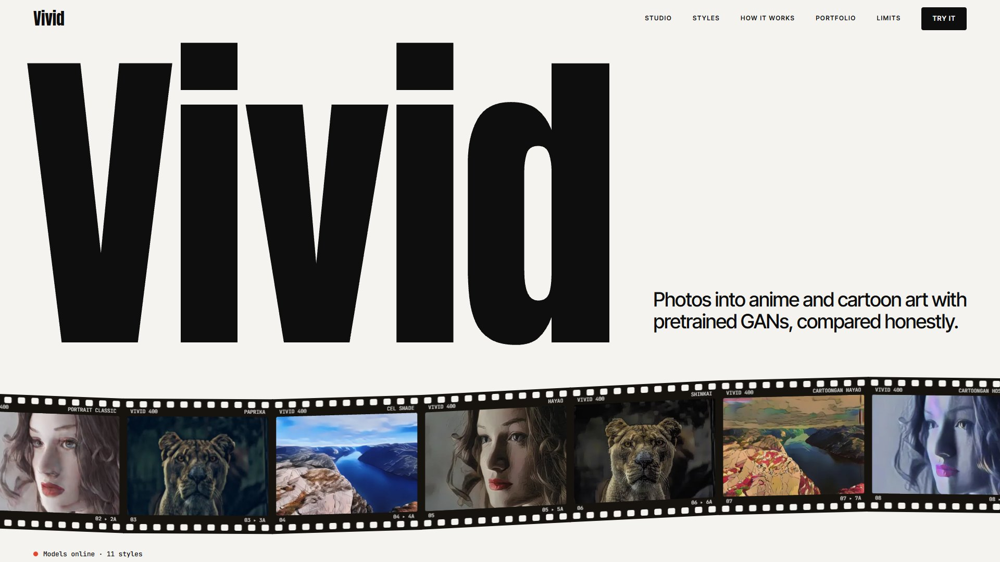

# Vivid

Photos into anime and cartoon art with pretrained GANs, compared honestly.

Final Gen AI project, Topic 128: Cartoonize Photos with AnimeGAN / CartoonGAN.

**Live demo:** _link coming soon_ <!-- TODO: paste the deployed URL here -->



Vivid runs 10 pretrained GAN styles and one classic filter with no AI over your photo, shows before
and after, measures what changed, and shows where the models fail.

## Run it locally

Needs Python 3.12 (PyTorch 2.4 wheels don't support the newest Python releases).

```bash
py -3.12 -m venv .venv312
.venv312\Scripts\activate              # Windows
# source .venv312/bin/activate         # macOS / Linux

pip install -r requirements.txt
python tools/download_weights.py       # once, about 220 MB, resumes if interrupted
python server.py
```

Open http://127.0.0.1:7860. After the weights are downloaded, no internet is needed.

Settings: `PORT` (default 7860) and `HOST` (default 127.0.0.1; use 0.0.0.0 in a container or to reach
it from another device). The webcam only works on localhost or HTTPS, because browsers require it.

The `Dockerfile`, `deploy/space_README.md` and `tools/deploy_space.py` are ready for Hugging Face Spaces deployment on a PRO account.

Run the tests:

```bash
pip install -r requirements-dev.txt
pytest tests
```

## Architecture

```
browser (frontend/, plain HTML, CSS, JS)
   |  POST /api/cartoonize  (photo, style, intensity, color_pop)
   v
server.py        FastAPI: validation, friendly errors, inference in worker threads
   v
registry.py      loads every model once; preprocess -> model -> postprocess -> metrics
   |-- AnimeGANv2   PyTorch, network code from torch.hub
   |-- AnimeGANv3   ONNX Runtime
   |-- CartoonGAN   cartoongan.py, PyTorch
   '-- filter       classic_filter.py, OpenCV
   v
metrics.py       SSIM, histogram shift, edge-density change
```

| Path | Purpose |
|---|---|
| `server.py` | API and static files |
| `registry.py` | Style catalogue, one interface for all models, result cache |
| `cartoongan.py`, `classic_filter.py` | CartoonGAN generator; filter with no AI |
| `weight_store.py`, `tools/download_weights.py` | Weight sources, SHA-256 checks, downloads |
| `metrics.py` | SSIM, color-histogram shift, edge-density change |
| `frontend/` | The website. No build step, fonts included |
| `tools/build_showcase.py` | Regenerates every image and number in `frontend/gallery/` |
| `tests/` | Registry and API tests |
| `cartoonize.py`, `compare.py`, `failure_cases.py`, `portfolio.py`, `run_all.py` | The original batch pipeline (see below) |

**API**

| Endpoint | Returns |
|---|---|
| `POST /api/cartoonize` | Result image, the matching original, four metrics. Form fields: `image`, `style`, `intensity` 0-100, `color_pop`, `max_side` 256-1024 |
| `POST /api/compare` | Every style at 512 px, with metrics |
| `GET /api/styles` | Styles with family, source and description |
| `GET /api/examples` | Sample photos |
| `GET /api/health` | Status and number of styles online |

JPG, PNG or WebP, up to 10 MB. Interactive docs are at `/docs`.

**Image handling.** Photos are turned upright (EXIF), resized so both sides are multiples of 32 and
the long side is 512 to 1024 px, with no square crop. CartoonGAN runs at 512 px, close to the size its
authors' test code uses.

**Speed.** Measured on a Ryzen 5 3500U laptop CPU: AnimeGANv3 about 4.6 s, CartoonGAN about 6.6 s,
AnimeGANv2 about 9.4 s, the filter 0.2 s (averages over the three sample photos). Changing intensity
or color pop afterwards takes under a second, because the model output is cached.

## Models, sources and licenses

| Styles | Network | Weights from | License |
|---|---|---|---|
| Portrait, Portrait Classic, Cel Shade | AnimeGANv2 generator | [bryandlee/animegan2-pytorch](https://github.com/bryandlee/animegan2-pytorch) (`face_paint_512_v2`, `face_paint_512_v1`, `celeba_distill`) | MIT |
| Paprika | AnimeGANv2 generator | Same repository, converted from [TachibanaYoshino/AnimeGANv2](https://github.com/TachibanaYoshino/AnimeGANv2) | MIT (port); the original AnimeGANv2 is non-commercial |
| Hayao, Shinkai | AnimeGANv3 | [TachibanaYoshino/AnimeGANv3](https://github.com/TachibanaYoshino/AnimeGANv3) release v1.1.0 | Non-commercial, academic use |
| CartoonGAN Hayao, Hosoda, Shinkai, Paprika | CartoonGAN (Chen, Lai, Liu, CVPR 2018) | Authors' weights, converted by [Yijunmaverick](https://github.com/Yijunmaverick/CartoonGAN-Test-Pytorch-Torch), from the [maciej3031/comixify](https://github.com/maciej3031/comixify) mirror because the original host is offline | Conversion code MIT; comixify repository CC BY-NC 4.0 |
| Classic Filter (no AI) | none | OpenCV | Apache 2.0 |

Several models are **non-commercial only**, so treat Vivid as an academic project. Style names refer to
the film directors whose frames the models were trained on; Vivid is not affiliated with them. Fonts
(Anton, Inter Tight, JetBrains Mono) are under the SIL Open Font License.

Being precise about the checkpoints, because a jury may ask:

- The four `bryandlee` checkpoints share one generator network but not one training recipe. Portrait and
  Portrait Classic were trained on 512x512 face images. `celeba_distill` appears to be the repository's
  "Webtoon Face" model: its notes describe a 256x256 model distilled using CelebA-HQ photos. Paprika is the
  original AnimeGANv2 film style, converted.
- Hayao and Shinkai here are AnimeGANv3, not v2.
- We checked our CartoonGAN port against published sample outputs for Hayao and Hosoda, and they match closely.
  Shinkai and Paprika use the same code, but there were no published samples to compare.

## How it works

**Generator.** A convolutional network that takes a photo and returns a picture. An *encoder* shrinks the
photo step by step, *residual blocks* transform it, and a *decoder* builds it back up to full size. The
output isn't a mask or a filter layer; it's a new image, drawn in a single pass.

**Adversarial loss.** During training, a second network, the *discriminator*, is shown real cartoon frames
and generated ones and must tell them apart. The generator is trained to fool it. This pushes results
toward real cartoon statistics: flat colour areas and clean edges.

**Content loss.** Fooling the discriminator isn't enough; the output must still show *your* photo. The
content loss compares photo and output in the feature space of a pretrained VGG network, so the same
things stay in the same places.

**Edge-promoting loss.** Introduced by CartoonGAN. The discriminator also sees real cartoon frames whose
edges were blurred, and must call them fake. The generator learns that blurry lines aren't cartoon lines.

**Style and colour losses.** Added by AnimeGAN. A grayscale style loss transfers anime texture without
copying its colours, and a colour loss keeps the photo's colours. CartoonGAN has neither, which is
probably why its colours drift more in our results.

**Unpaired image-to-image translation.** Nobody has drawn the cartoon twin of every photo. Training uses
two unrelated collections, real photos and real cartoon frames, with no matching pairs. This is the same
family of problem as CycleGAN, though these models keep the content with a VGG loss instead of CycleGAN's
cycle consistency. The number of paired training images needed is zero.

AnimeGANv3 is a later design with a two-tail generator and more losses; the ideas above still apply.
Only the generator runs when you use Vivid. The discriminator and losses exist only during training.

## Metrics

| Metric | Meaning |
|---|---|
| SSIM | Structural similarity to the photo. 1 is identical |
| Hist shift | Distance between colour histograms. 0 is the same palette |
| Edge Δ | Change in the share of edge pixels. Can be huge for soft photos that start with few edges |
| ms | Time the model took |

None of these means better or worse: a cartoon is supposed to change the photo.

## Known limitations

- **Faces.** The models only know faces like their training data. Close-ups, hard light and low resolution
  push them outside it. Paprika draws cracks on bright, smooth skin; Portrait invents eye and brow detail
  that isn't in a 128 px photo.
- **Fine detail.** Training rewards flat shapes with clean lines, so leaves, hair and fabric get smeared or
  replaced by a pattern. It's a side effect of the goal, not a bug.
- **Colour drift.** CartoonGAN can turn a blue sky brown or green. CartoonGAN Hayao also leaves artifacts
  near the corners of smooth skies.
- **Temporal flicker.** Each image is drawn from scratch. Move a photo by 5 pixels, line the two outputs up
  again, and 7.8% of pixels still differ by more than 3% (Hayao). In video that is visible flicker.
- **Not a filter, for better and worse.** A filter applies one fixed recipe to every pixel. A GAN reacts to
  what is in the picture, which makes it look drawn, but it can also make mistakes a filter never could,
  like bending a face.
- **CPU speed.** Several seconds per photo on a laptop. One style runs at a time.

## The original batch pipeline

Still works, for offline batches with three AnimeGANv2 checkpoints:

```bash
python cartoonize.py       # inputs/ -> outputs/{model}/
python compare.py          # contact sheets and outputs/metrics.csv
python failure_cases.py    # face close-up and busy-background stress test
python portfolio.py        # builds portfolio/index.html
python run_all.py          # all four
```

These scripts use `face2paint`, which centre-crops every photo to a 512x512 square, so their numbers differ
from the website's, which keeps the whole frame. Every script takes `--help`.
